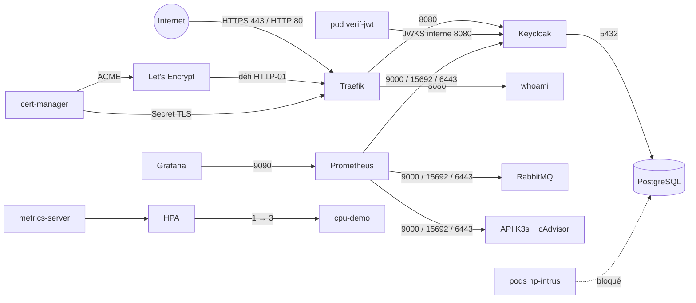
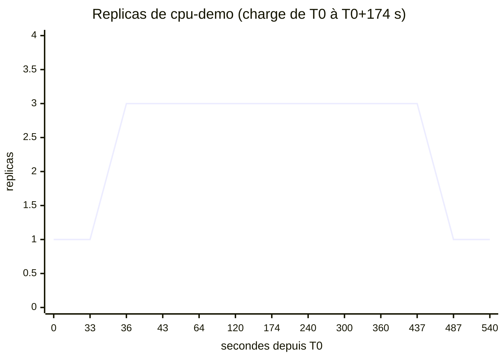

# Expérience 1 — Socle K3s : rapport

- Dates : 2026-10-28 et 2026-10-29
- Détail des commandes et des résultats : `docs/experimentations/exp1-installation-k3s-journal.md` (appelé « le journal »)
- Fichiers de l'expérience : `experimentations/exp1/`

## 1. Objectif

Vérifier que le VPS (serveur privé virtuel) de 4 Go peut porter la plateforme du POC, avant d'écrire les services
(`docs/cadrage.md` §3, point 1) :
RAM réelle de chaque composant, HTTPS par Traefik + cert-manager + Let's Encrypt, Keycloak avec issuer public et JWKS
(JSON Web Key Set) interne, HPA (Horizontal Pod Autoscaler) de 1 à 3 replicas sous charge, application des NetworkPolicies.
Ce rapport répond au critère E1 (`docs/sujet/consignes.md` §1.2.2, repris dans `docs/cadrage.md` §4).

## 2. Environnement

| Élément | Valeur |
|---|---|
| VPS | 2 vCPU, 3,7 Gio de RAM utilisable, swap 2 Go, Ubuntu 24.04, Europe |
| Pare-feu du VPS (UFW) | 22, 80, 443 ouverts ; 6443 (API Kubernetes) fermé ; réseaux des pods et des services autorisés en interne |
| Cluster | K3s v1.36.5+k3s1 mono-nœud (Traefik, ServiceLB, CoreDNS, metrics-server, kube-router intégrés) |
| Namespace | `sandbox` (bac à sable) ; cert-manager dans `cert-manager` |
| Domaines | `epouvante.menuly-app.com` (whoami), `auth.epouvante.menuly-app.com` (Keycloak) |
| Pilotage | poste Windows, `ssh` + `kubectl` sur le VPS ; console d'administration par tunnel SSH |

## 3. Technologies testées et interactions

| Composant | Version | Rôle dans l'expérience |
|---|---|---|
| K3s | v1.36.5+k3s1 | orchestrateur |
| Traefik (intégré à K3s) | — | Ingress, terminaison TLS, redirection HTTPS, HSTS |
| cert-manager | v1.21.3 | certificats Let's Encrypt (HTTP-01), staging puis production |
| Keycloak | 26.8.1 | fournisseur OIDC (OpenID Connect), realm de test |
| PostgreSQL | 18.6 | base de Keycloak |
| RabbitMQ | 4.4.0 | mesure de RAM seulement (le broker est l'objet de l'expérience 2) |
| Prometheus | 3.15.1 | collecte des métriques (Keycloak, RabbitMQ, cAdvisor, API) |
| Grafana | 13.3.0 | tableau de bord « Démo HPA » |
| metrics-server + HPA | intégré | montée en charge sur le CPU |
| NetworkPolicies (kube-router) | intégré | pare-feu interne au cluster |

## 4. Étapes pour reproduire

Les fichiers sont appliqués dans l'ordre de leur numéro ; chaque étape est détaillée dans le journal.

| Partie (journal) | Fichiers | Ce qui est fait |
|---|---|---|
| 1. Installation | — (commandes du journal, étapes 1 à 4) | règles UFW, installation de K3s, `kubectl` pour l'utilisateur `ubuntu` |
| 2. RAM de la stack | `00`, `10`, `20`, `30`, `40`, `50` | namespace, PostgreSQL, Keycloak, RabbitMQ, Prometheus, Grafana ; mesure un par un |
| 3. HTTPS | `60`, `61`, `62` | cert-manager, `ClusterIssuer` staging et production, whoami exposé |
| 4. Keycloak public | `70` à `74` | Ingress de Keycloak, realm `epouvante-test`, vérification des jetons, console par tunnel |
| 5A. HPA | `51`, `80`, `81` | tableau de bord, application `cpu-demo`, script de mesure (CSV) |
| 5B. NetworkPolicies | `97`, `98`, puis `90` à `96` | pods intrus, matrice de 19 flux, refus total puis ouvertures une par une |

## 5. Résultats et mesures

**Partie 1 — K3s** (journal, « Synthèse des mesures ») : nœud prêt en quelques minutes ; K3s coûte ≈ 650 Mio à vide
(569 Mio → 1,2 Gio utilisés), dont seulement 51 Mio pour les pods système.

**Partie 2 — Stack au repos** (journal, « Bilan de la partie 2 ») : 949 Mio pour les 5 composants (`kubectl top`), dont
plus de la moitié pour Keycloak ; 1,6 Gio restent disponibles. Aucun OOM (arrêt pour manque de mémoire).

**Partie 3 — HTTPS** (journal, « Bilan de la partie 3 ») : certificats de production pour les deux sous-domaines,
émis en moins de 30 s ; cert-manager pèse 76 Mio. Décision consignée dans `docs/adr/0001-conserver-cert-manager.md`.

**Partie 4 — Keycloak** (journal, « Bilan de la partie 4 ») : 5 objectifs atteints. Keycloak démarre en mode production
(prêt en 1 min 47 s) ; la console d'administration n'est pas publique ; un jeton est accepté avec l'issuer public et les
clés lues par l'adresse interne, et refusé avec un mauvais issuer, une audience inconnue ou un rôle ajouté (9 cas conformes).

**Partie 5A — HPA** (journal, étape A2) : passage de 1 à 3 replicas à T0 + 36 s, pods prêts à T0 + 38 s ; retour à 1
replica 313 s après l'arrêt de la charge (fenêtre de stabilisation de 300 s) ; CPU du nœud à 50 % ; RAM disponible
jamais sous 1 277 Mio.

**Partie 5B — NetworkPolicies** (journal, « Bilan de la partie B ») : K3s applique les règles ; avec 15 règles, la matrice
de 19 flux est conforme (0 écart) après redémarrage des pods ; coût en RAM non mesurable.

## 6. Difficultés et solutions

| Difficulté (partie du journal) | Cause | Solution |
|---|---|---|
| RabbitMQ redémarre une fois (2, F à H) | la sonde, lancée en root, crée le cookie Erlang que le serveur ne peut plus lire | pod non-root (`runAsUser: 100`) |
| Grafana à 1 Gio au démarrage (2, K et L) | téléchargement de 433 Mo de plugins à chaque démarrage | `GF_PLUGINS_PREINSTALL_DISABLED=true` |
| Enregistrement CAA invisible sous Windows (3) | `nslookup` ne l'affiche pas | requête DNS over HTTPS |
| Page de connexion servie en HTTP clair (4, étape 6) | avec `KC_HOSTNAME` en URL https, Keycloak croit toute requête en HTTPS ; `sslRequired` est sans effet | redirection HTTP → HTTPS et HSTS dans Traefik |
| Console d'administration en erreur (4, étape 7) | la console passe par l'URL de frontend du realm `master`, non routée | URL de frontend de `master` sur l'adresse du tunnel |
| Processus orphelins après un tunnel (4) | `kubectl port-forward` survit à la fermeture de SSH | `ssh -t` obligatoire |
| Coupure SSH pendant la mesure du HPA (5, A2) | session longue interrompue | descente reconstituée par `lastScaleTime` et Prometheus ; à l'avenir `nohup` sur le VPS |
| 19 écarts sur 19 sans aucune règle (5, B1) | `timeout` ne sait pas lancer une fonction bash | fonctions exportées, `bash -c` ; référence refaite : 0 écart |
| Connexions ouvertes non coupées par le refus total (5, B2) | le suivi de connexions du noyau laisse passer l'existant | valider sur des connexions neuves et par redémarrage des pods (B9) |
| Prometheus ne joint plus l'API (5, B6) | la règle doit viser l'IP du nœud, port 6443, pas l'adresse du service | règle en deux parties |

## 7. Limites

- **JVM Spring Boot non mesurées** : l'application du test HPA (PHP, 12 à 15 Mio par replica) valide le mécanisme et ses
  délais, pas la RAM de `troc-service` à 3 replicas.
- Aucune charge réelle sur Keycloak, PostgreSQL ou RabbitMQ : toutes les mesures de RAM sont au repos.
- Renouvellement des certificats non observé (premier renouvellement le 2026-12-27) ; pas de certificat wildcard.
- Pas de vrai resource server Spring (validation des jetons par script) ; refresh token et rotation non testés.
- Image Keycloak non optimisée : pic de mémoire à la limite (768Mi) et un cœur occupé au démarrage.
- IP réelle des clients perdue par ServiceLB (tous vus en `10.42.0.1`) : correction non testée.
- Mono-nœud : aucune haute disponibilité.

## 8. Conclusion par composant

| Composant | Décision | Justification |
|---|---|---|
| K3s mono-nœud | **Adopté** | stable, 0 redémarrage ; coût fixe de 650 Mio à intégrer au budget |
| Traefik | **Adopté** | TLS, redirection HTTPS et HSTS fonctionnent ; correction de l'IP client à faire avant le rate limiting |
| cert-manager + Let's Encrypt | **Adopté** | 76 Mio, émission < 30 s (ADR 0001) |
| Keycloak | **Adopté sous condition** | fonctionnel, mais le plus gros poste de RAM : image optimisée et administrateur permanent à faire |
| PostgreSQL | **Adopté** | 45 Mio au repos, une instance pour toutes les bases |
| RabbitMQ | **Adopté** (après l'expérience 2) | 83 Mio au repos et non-root ; confirms, ack, DLQ et absence de perte validés par l'expérience 2 (`docs/experimentations/exp2-rabbitmq-rapport.md`) |
| Prometheus | **Adopté** | 40 Mio pour 5 100 séries |
| Grafana | **Adopté** | 208 Mio de mémoire propre, à condition de désactiver les plugins préinstallés |
| metrics-server + HPA | **Adopté** | montée en 38 s, descente en 313 s, conformes aux valeurs par défaut |
| NetworkPolicies | **Adopté** | appliquées par K3s, matrice conforme ; méthode de validation imposée (§6) |

Aucun composant n'est rejeté.

## 9. Impact sur le cadrage

- **Budget RAM** (`docs/cadrage.md` §1.4.18, question ouverte du §7) : le poste « Système + K3s » vaut ≈ 1 250 Mio et non
  600 ; Grafana et Keycloak dépassent aussi l'estimation. Le budget révisé est proposé à part, à valider avant d'être
  reporté dans le cadrage.
- **HPA** (`docs/cadrage.md` §1.4.17) : les deux services ne pourront pas être au maximum en même temps (journal, bilan de
  la partie 2) ; la montée de `notification-service` est à revoir.
- **Dashboard « Montée en charge »** (§1.4.16) : nombre de replicas lu dans kube-state-metrics (les séries cAdvisor restent
  visibles 5 min après la descente).
- **Durcissement** (§1.4.14) : redirection HTTPS et HSTS à mettre sur chaque Ingress ; règle API sur l'IP du nœud ;
  `troc-service` et `notification-service` doivent réessayer leurs premières connexions (≈ 1 s de refus total au démarrage
  d'un pod).
- **Resource servers** (§1.2.9) : `issuer-uri` public et `jwk-set-uri` interne confirmés, à fixer explicitement.
- Liste complète : journal, « À reprendre au déploiement de `app` ».

## 10. Pour la soutenance

### RAM par composant (au repos)

| Composant | `kubectl top` | Mémoire propre (`anon`) | Remarque |
|---|---|---|---|
| Système + K3s | ≈ 1 230 Mio (`free`) | — | 650 Mio pour K3s seul |
| Keycloak | 549 à 590 Mio | 531 à 534 Mio | pic à 768 Mio au démarrage |
| Grafana | 232 Mio | 208 Mio | jusqu'à 508 Mio avec le cache de fichiers |
| RabbitMQ | 83 Mio | 63 Mio | pic 166 Mio au démarrage |
| cert-manager (3 pods) | 76 Mio | — | après 4 émissions |
| PostgreSQL | 45 Mio | 13 Mio | mémoire partagée hors `anon` |
| Prometheus | 40 Mio | 38 Mio | ≈ 5 100 séries |
| **Disponible avec toute la stack** | **1,4 à 1,6 Gio** | | |

### HPA : replicas de `cpu-demo` (T0 = début de la charge)

Relevés du CSV `hpa-20261028T171722Z.csv` (journal, étape A2) ; le point à 487 s vient de `lastScaleTime` (le relevé
s'est arrêté à 437 s). Montée : décision à 36 s, directement de 1 à 3. Descente : 313 s après l'arrêt de la charge,
directement de 3 à 1.

### NetworkPolicies : matrice avant / après

| Flux (19 tests de `98-tester-flux.sh`) | Avant (aucune règle) | Après (15 règles, pods redémarrés) |
|---|---|---|
| DNS depuis un pod de `sandbox` | passe | passe |
| Keycloak → PostgreSQL ; sonde de Keycloak | passe | passe |
| Traefik → Keycloak ; HTTPS public `auth.` | passe | passe |
| Prometheus → Keycloak, RabbitMQ, API ; `up` des 3 cibles | passe | passe |
| Grafana → Prometheus ; Traefik → whoami ; HTTPS public `epouvante.` | passe | passe |
| Intrus de `sandbox` → PostgreSQL (par nom, par IP) | **passe** | **bloqué** |
| Intrus de `default` → PostgreSQL (par nom, par IP) | **passe** | **bloqué** |
| Intrus de `sandbox` → Keycloak (par IP) | **passe** | **bloqué** |

Résultat : 0 écart sur 19 dans les deux cas ; seuls les flux non autorisés changent.

### Les 3 difficultés marquantes

1. **Page de connexion en HTTP clair** : Keycloak servait son formulaire en HTTP malgré `sslRequired`, parce qu'il croit
   toute requête en HTTPS quand `KC_HOSTNAME` est une URL https ; la redirection et le HSTS ont été placés dans Traefik.
2. **Script de test cassé** : la matrice lancée avant toute règle a donné 19 échecs sur 19, ce qui a révélé un défaut du
   script (`timeout` ne lance pas une fonction bash) avant qu'il ne fausse les vrais résultats.
3. **Connexions ouvertes qui survivent aux règles** : sous refus total, Keycloak restait prêt grâce à ses connexions déjà
   ouvertes vers PostgreSQL ; chaque règle est donc validée sur des connexions neuves et après redémarrage des pods.
