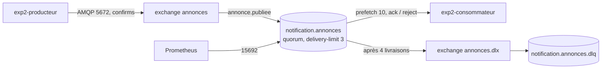

# Expérience 2 — Broker RabbitMQ (version courte) : rapport

- Date : 2026-10-29 (14:21 → 15:10 UTC)
- Détail des commandes et des résultats : `docs/experimentations/exp2-rabbitmq-journal.md` (appelé « le journal »)
- Fichiers de l'expérience : `experimentations/exp2/`

## 1. Objectif

Vérifier sur le VPS la décision « au moins une fois » (`docs/cadrage.md` §1.2.8) et les comptes au moindre privilège
(§1.2.10) avant d'écrire `notification-service` : publication confirmée, file durable, ack après traitement, 3 réessais
puis DLQ (dead letter queue), aucune perte pendant une panne du consommateur, RAM de RabbitMQ. NATS : RAM au repos
seulement, pour comparer (`docs/cadrage.md` §3.2, réduit d'un commun accord ; « Could » au §5).
Ce rapport répond au critère E1 (`docs/sujet/consignes.md` §1.2.2, repris dans `docs/cadrage.md` §4).

## 2. Environnement

| Élément | Valeur |
|---|---|
| Cluster | K3s v1.36.5+k3s1 mono-nœud, namespace `sandbox` (refus total des NetworkPolicies actif) |
| VPS | 2 vCPU, 3,7 Gio utilisables ; 1,5 Gio disponibles avant et après l'expérience |
| Clients de test | Python 3.13 + pika 1.3.2, image `exp2-amqp` construite en local et importée dans K3s sans registre |
| Pilotage | poste Windows (Git Bash, Docker Desktop), `ssh` + `kubectl` sur le VPS |

## 3. Technologies testées et interactions

| Composant | Version | Rôle |
|---|---|---|
| RabbitMQ | 4.4.0 (`management-alpine`, déjà en place depuis l'exp. 1) | broker ; file quorum, DLQ, plugin Prometheus |
| NATS + JetStream | 2.15.2 (`alpine`) | mesure de RAM au repos seulement |
| Pods `exp2-producteur` / `exp2-consommateur` | image `exp2-amqp:2` | non-root, système de fichiers en lecture seule, 32/64 Mio |

## 4. Étapes pour reproduire

| Étape (journal) | Fichiers | Ce qui est fait |
|---|---|---|
| 1. Mise en place | `app/`, `10`, `20`, `30`, `31`, `32` | image, comptes et Secrets, NetworkPolicies, topologie (Job admin), pods |
| 2. Nominal | — | 100 messages ; lecture tentée par le producteur |
| 3. DLQ | `app/consommateur.py` | message poison rejeté jusqu'à la DLQ, lecture des en-têtes |
| 4. Panne | `40-panne.sh` | 1 000 messages à 20 msg/s, SIGKILL du consommateur à T+15 s |
| 5. RAM | `50-ram.sh` | repos, effet d'une commande CLI, 10 000 messages de 1 Ko en attente |
| 6. NATS | `60-nats.yaml` | déploiement, 2 min de repos, mesure, suppression |
| 7. Nettoyage | — | retour à l'état initial |

## 5. Résultats et mesures

**Échange nominal** (étape 2) : 100 confirmés, 100 traités une fois ; le producteur reçoit `403 ACCESS_REFUSED` en lecture.

**Réessais et DLQ** (étape 3b) : 1 livraison + 3 réessais (`x-delivery-count` 0 → 3), puis DLQ avec
`x-first-death-reason=delivery_limit` et l'origine du message dans `x-death`.

**Panne du consommateur** (étape 4, essai 2) : 1 000 confirmés, 1 000 identifiants traités, **0 manquant**, 0 doublon ;
les 10 messages en cours ont été relivrés une fois ; la file est montée à 500 messages puis s'est vidée en 1 min.

**RAM de RabbitMQ** (étape 5) : 95 Mio au repos, 126 Mio avec 10 000 messages en attente ; chaque sonde
`rabbitmq-diagnostics` ajoute ≈ 60 Mio pendant 4 s ; pic observé 270 Mio (sonde + `rabbitmqctl` + charge).
Débit : 10 000 messages confirmés un par un en 40,6 s (≈ 246 msg/s).

**NATS** (étape 6) : 4 Mio (cgroup) à 15 Mio (mémoire résidente selon NATS) au repos, 8m CPU, contre 95 Mio et 135m
pour RabbitMQ.

## 6. Difficultés et solutions

| Difficulté (étape) | Cause | Solution |
|---|---|---|
| Message poison relivré en boucle, jamais en DLQ (3) | depuis RabbitMQ 4.3, `basic.nack` ne fait pas avancer le compteur comparé à `x-delivery-limit` | `basic.reject(requeue=True)` |
| Test de panne sans message en jeu (4, essai 1) | 1 000 messages envoyés en 5,9 s, avant la panne | débit fixé à 20 msg/s, consommateur ralenti à 10 msg/s |
| Pics de RAM inexpliqués (4, 5) | `rabbitmqctl` et la sonde lancent une seconde VM Erlang dans le conteneur | relevés sans CLI (`memory.current`, endpoint Prometheus) |
| 280 ms par publication à l'étape 2 | non établie ; non reproduite ensuite (≈ 4 à 6 ms) | suivi pendant les campagnes de charge |

## 7. Limites

- Clients Python, pas Spring AMQP : le comportement de Spring (nack ou reject, retry) reste à vérifier.
- Pas de panne du broker : stockage `emptyDir`, les messages ne survivraient pas à la perte du pod RabbitMQ.
- Réessais immédiats, sans délai entre eux ; une panne du consommateur compte comme un échec (3 pannes → DLQ).
- Perte possible entre commit et publication non testée (limite assumée du cadrage, outbox au plan de remédiation).
- NATS : RAM au repos seulement ; ni débit, ni rétention, ni DLQ (absente nativement de JetStream).

## 8. Conclusion par composant

| Composant | Décision | Justification |
|---|---|---|
| RabbitMQ 4.4 (file quorum + DLQ) | **Adopté** | aucune perte, DLQ conforme, moindre privilège effectif ; 95 à 130 Mio sans sonde CLI |
| Sonde `rabbitmq-diagnostics` | **Rejetée pour `app`** (ADR 0005) | +60 Mio toutes les 20 s ; une sonde `tcpSocket` suffit |
| NATS JetStream | **Non retenu** | 6 à 25 fois moins de RAM, mais pas de DLQ native, et le cadrage s'appuie sur confirms/ack/DLQ de RabbitMQ ; écart de ≈ 90 Mio absorbable par le budget |

## 9. Impact sur le cadrage (validé le 2026-10-29, reporté dans `docs/cadrage.md`, US3 et l’ADR 0005)

- **§1.2.8** : « 3 tentatives » à corriger en « 3 réessais (4 livraisons) » ; rejet par `basic.reject` (ou retry Spring
  puis rejet sans remise en file), jamais `basic.nack` avec remise en file.
- **US3** : ajouter un test Testcontainers « message en échec → DLQ après 4 livraisons » sur RabbitMQ ≥ 4.3.
- **Budget RAM** (§1.4.18, ADR 0005) : RabbitMQ 128 / 256 Mio, 130 Mio au pic avec une sonde `tcpSocket` (au lieu
  de 120 Mio « à confirmer »).
- **Indicateur 3** (§1.3.11) : vérifier en charge la latence de la confirmation dans `POST /annonces` ; si besoin,
  confirmations asynchrones.

## 10. Pour la soutenance

### Ce que prouve le test de panne

| Mesure | Valeur |
|---|---|
| Messages confirmés par le broker | 1 000 / 1 000 |
| Traités avant / après la panne | 131 / 869 |
| Identifiants manquants | **0** |
| Relivrés après la panne | 10 (le prefetch), `x-delivery-count` = 1 |
| Profondeur maximale de la file | 500 messages |

### RAM au repos : RabbitMQ et NATS

| Broker | RAM | CPU |
|---|---|---|
| RabbitMQ 4.4 | 95 Mio (126 avec 10 000 messages) ; +60 Mio par sonde CLI | 135m |
| NATS 2.15 + JetStream | 4 à 15 Mio | 8m |

### Les 2 difficultés marquantes

1. **Le message poison qui ne meurt jamais** : 746 livraisons en 10 s, car RabbitMQ 4.3 ne compte plus `nack` comme un
   échec ; un risque réel pour `notification-service`, désormais couvert par un test prévu dans US3.
2. **La sonde qui coûte plus que la file** : 10 000 messages coûtent 31 Mio, une sonde de disponibilité 60 Mio.
