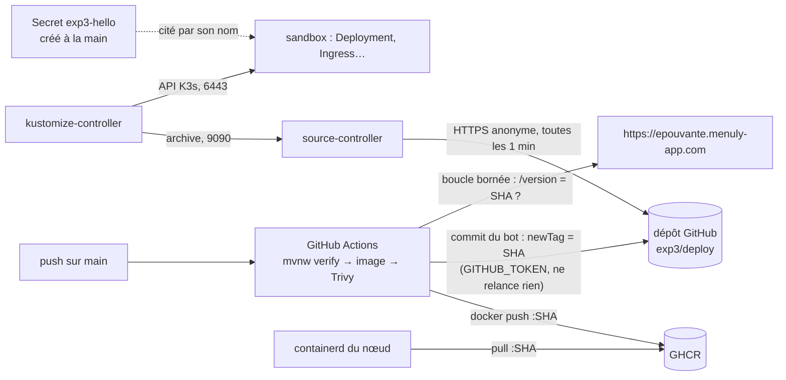

# Expérience 3 — Livraison continue (GitHub Actions → GHCR → Flux) : rapport

- Date : 2026-10-29 (15:30 → 16:20 UTC)
- Détail des commandes et des résultats : `docs/experimentations/exp3-livraison-continue-journal.md` (appelé « le journal »)
- Fichiers de l'expérience : `experimentations/exp3/` (`hello/`, `deploy/`, `flux/`), `.github/workflows/exp3-hello.yml`

## 1. Objectif

Valider la chaîne de livraison du POC avant d'y mettre nos services : build, test, scan et publication de l'image dans
GitHub Actions, déploiement automatique par Flux, secrets hors du dépôt public, vérification du SHA en ligne en HTTPS
(`docs/cadrage.md` §1.3.12, §1.3.13, §1.4.15, §3.3). Trancher la question ouverte « mode de suivi des nouvelles images
par Flux » (§7) et mesurer la RAM de Flux (§1.4.18, 200 Mio prévus).
Ce rapport répond au critère E1 (`docs/sujet/consignes.md` §1.2.2, repris dans `docs/cadrage.md` §4).

## 2. Environnement

| Élément | Valeur |
|---|---|
| Cluster | K3s mono-nœud ; application dans `sandbox`, Flux dans `flux-system` (refus total des NetworkPolicies dans les deux) |
| VPS | 2 vCPU, 3,7 Gio ; 1,5 Gio disponibles avant, 1,3 Gio avec Flux et l'application, 1,4 Gio après nettoyage |
| CI | GitHub Actions, runner `ubuntu-24.04`, dépôt public, `main` non protégée |
| Registre | GHCR (GitHub Container Registry), paquet public |
| Poste | Windows, Git Bash, Docker Desktop ; JDK 17 seulement, outils lancés par leurs images Docker |

## 3. Technologies testées et interactions

| Composant | Version | Rôle |
|---|---|---|
| Application `exp3-hello` | Java 25, Spring Boot 4.1.2, Maven Wrapper 3.3.4 (Maven 3.9.11) | page « hello » et `GET /version` (`sha`, `secretPresent`) |
| Image | `gcr.io/distroless/java25-debian13:nonroot` | sans shell, UID 65532, système de fichiers en lecture seule |
| GitHub Actions | actions épinglées par SHA (checkout v7.0.1, setup-java v6.1.0, buildx v4.4.1, build-push v7.4.0, login v4.7.0, trivy-action v0.36.0) | build, test, scan, push, écriture du tag, vérification |
| Trivy | 0.76.1 | scan d'image, bloquant si critique ou haute |
| Flux | v2.9.6 : source-controller v1.9.6, kustomize-controller v1.9.6 | lecture du dépôt, application des manifests |

## 4. Étapes pour reproduire

| Étape (journal) | Fichiers | Ce qui est fait |
|---|---|---|
| 0. Vérifications | — | outils du poste, état du dépôt, versions, SHA des actions |
| 1. Application | `hello/` | Maven Wrapper vérifié par empreinte, test JUnit rouge puis vert, image, scan Trivy local |
| 2. Workflow | `.github/workflows/exp3-hello.yml`, `deploy/` | workflow, manifests kustomize ; premier run (image sur GHCR) |
| 3. Secret | — | Secret `exp3-hello` créé sur le VPS depuis un `.env` éphémère |
| 4–5. Flux | `flux/` | retrait de l'Ingress whoami, installation de Flux, NetworkPolicies, synchronisation |
| 6. Bout en bout | — | un push → nouvelle version en ligne, sans intervention |
| 7. RAM | — | repos, réconciliation forcée, pic des cgroups |
| 8. Secrets | — | gitleaks sur l'historique, contenu de l'image publiée |
| 9. Nettoyage | — | Kustomization, GitRepository et Secret supprimés ; Flux conservé |

## 5. Résultats et mesures

**Chaîne complète** (étape 6) : push à 16:06:24, commit du bot à 16:07:56, bon SHA en ligne à 16:08:43, soit
**2 min 19 s sans intervention**. La CI prend 1 min 32 s ; Flux détecte et déploie en ≈ 45 s.

**Pas de boucle** (étapes 2 et 6) : 2 runs au total pour 2 push ; aucun run après les 2 commits du bot.

**Sécurité du pipeline** : 0 vulnérabilité critique ou haute (OS et jar) ; permissions du workflow limitées à
`contents: write` et `packages: write` ; aucun secret ajouté à GitHub (GHCR utilise `GITHUB_TOKEN`).

**Secrets** (étapes 3 et 8) : valeur générée sur le VPS et jamais affichée ; gitleaks : 35 commits, aucune fuite ;
image publiée sans trace du secret. Le dépôt ne contient que le nom `exp3-hello` et la clé `DEMO_SECRET`.

**HTTPS** (étape 5) : HTTP → 301 vers HTTPS, HSTS d'un an, certificat Let's Encrypt existant repris sans réémission.

**RAM de Flux** (étape 7) : **≈ 50 Mio au repos** (kustomize 31, source 21), **≤ 100 Mio au pic** (kustomize 71, source 29).

## 6. Difficultés et solutions

| Difficulté (étape) | Cause | Solution |
|---|---|---|
| `mvnw` refuse l'empreinte de Maven (1) | sans `unzip`, `mvnw` télécharge le `.tar.gz` au lieu du `.zip` déclaré, l'empreinte ne correspond plus ; l'URL `.tar.gz` est refusée | URL `.zip` et son empreinte ; `unzip` présent sur les runners ; en local, image JDK 25 + `unzip` + `curl` |
| `eclipse-temurin:25-jdk` sans `curl` ni `wget` (1) | image minimale | même image locale que ci-dessus |
| Limites par défaut de Flux : 1 Gio et 1 CPU par contrôleur (préparation) | valeurs de `flux install` | patch kustomize à 256 Mio / 500m, fichier généré non modifié |
| Démarrage d'environ 30 s sur le VPS (9) | 500m de CPU au démarrage de la JVM (1,6 s sur le poste) | `startupProbe` de 60 s ; à dimensionner pour les services |

## 7. Limites

- **NetworkPolicies** : pas de filtrage par nom de domaine ; la sortie de source-controller est ouverte vers tout le 443
  hors du cluster, pas seulement GitHub.
- **Droits de Flux** : kustomize-controller est administrateur du cluster ; pour `app`, piste d'un compte de service
  dédié (`serviceAccountName`) limité au namespace.
- **Pas d'alerte de Flux** : notification-controller non installé ; un échec de réconciliation n'est visible que par la
  vérification du SHA dans la CI (ou `kubectl`).
- **Détection par scrutation** : jusqu'à 1 min de délai ; pas de webhook (l'API du cluster n'est pas exposée).
- **Historique** : un commit du bot par livraison sur `main`. Si `main` devient protégée (`docs/cadrage.md` §1.2.19), le bot
  devra être autorisé à contourner la règle.
- **Un seul job** : la vérification HTTPS et le build sont dans le même run ; un échec de déploiement fait échouer un
  build valide (vu au premier run, voulu ici).
- **Pas de retour arrière automatique** : revenir à une version = revert du commit du bot (Flagger hors périmètre, §6).
- Pas testé : échec du scan Trivy (aucune vulnérabilité trouvée), échec d'un test dans la CI, panne de GitHub.

## 8. Conclusion par composant

| Composant | Décision | Justification |
|---|---|---|
| GitHub Actions + GHCR, image taguée avec le SHA | **Adopté** | build → push en 1 min 22 s ; image testée = image publiée ; aucun secret ajouté |
| Trivy dans la CI (image, bloquant) | **Adopté** | 30 s par run ; version de Trivy et action épinglées |
| Flux (source + kustomize, sans bootstrap) | **Adopté** | déploiement en ≈ 45 s, ≈ 50 Mio ; aucun accès en écriture au dépôt, aucune clé dans le cluster |
| Suivi des images : tag écrit par la CI | **Adopté** | 2 contrôleurs au lieu de 4, aucune clé GitHub en écriture dans le cluster, tag SHA utilisable tel quel |
| Image automation de Flux | **Non retenu** | clé en écriture dans le cluster, tag triable nécessaire, 2 contrôleurs de plus (non mesuré) |
| Secret créé à la main, cité par son nom | **Adopté** | valeur absente du dépôt, de la CI et de l'image ; limite connue : pas de rotation (Sealed Secrets au plan de remédiation) |
| Image distroless Java 25 | **Adoptée** | 0 vulnérabilité critique/haute, 91 Mo, sans shell |

## 9. Impact sur le cadrage (à valider)

- **§7 (question ouverte)** : mode de suivi tranché, la CI écrit le tag dans le dépôt et Flux lit le dépôt.
- **§1.4.18 (budget RAM)** : Flux 100 Mio au pic au lieu de 200 Mio (≈ 50 Mio au repos) ; limites 256 Mio / 500m par
  contrôleur ; marge du budget portée de ≈ 90 à ≈ 190 Mio.
- **§1.4.14 (NetworkPolicies)** : « Flux → GitHub/GHCR » devient « Flux → GitHub (443 hors cluster) et API K3s » ;
  aucune règle vers GHCR (le téléchargement des images est fait par containerd sur le nœud).
- **§1.2.19 (dépôt)** : si `main` est protégée, autoriser `github-actions[bot]` à pousser le commit du tag.
- **Services** : `startupProbe` dimensionnée pour un démarrage d'environ 30 s à 500m de CPU.
- **Fait pendant l'expérience** : Java 25 et Maven Wrapper pour tous les projets (§1.4.20, décision du 2026-10-29) ;
  Flux conservé dans `flux-system` pour `app`.
- **Workflow `exp3-hello`** : déclencheur `push` remplacé par `workflow_dispatch` (lancement manuel seulement) après
  l'expérience, l'application n'étant plus déployée (décision du 2026-10-29).

## 10. Pour la soutenance

### Le chemin d'un commit

| Moment (UTC) | Événement | Durée cumulée |
|---|---|---|
| 16:06:24 | push sur `main` | 0 s |
| 16:07:56 | image testée, scannée, poussée ; tag écrit par le bot | 1 min 32 s |
| 16:08:43 | nouvelle version en ligne en HTTPS (bon SHA) | **2 min 19 s** |

### Ce qui garantit l'absence de secret dans le dépôt public

| Contrôle | Résultat |
|---|---|
| Valeur générée sur le VPS, `.env` supprimé | jamais sur le poste ni dans la CI |
| gitleaks sur tout l'historique | 35 commits, aucune fuite |
| Variables et couches de l'image publiée | aucune trace du secret |

### Les 2 difficultés marquantes

1. **Le wrapper qui change de fichier** : `mvnw` télécharge un autre format quand `unzip` manque, et sa propre
   vérification d'intégrité échoue ; une fausse alerte de « distribution compromise » à comprendre avant de désactiver
   le contrôle.
2. **Pas de boucle sans le vouloir** : le commit du bot pourrait relancer la CI à l'infini ; deux protections
   indépendantes (jeton `GITHUB_TOKEN`, filtre de chemins), vérifiées sur 2 livraisons.
