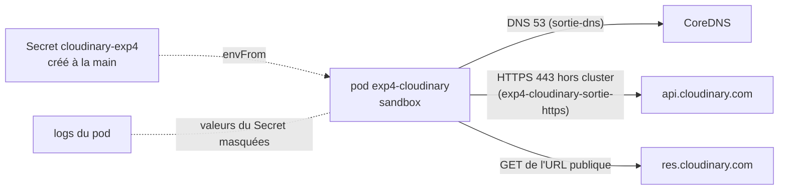

# Expérience 4 — Cloudinary depuis un pod : rapport

- Date : 2026-10-30 (13:01 → 13:05 UTC sur le VPS)
- Détail des commandes et des résultats : `docs/experimentations/exp4-cloudinary-journal.md` (appelé « le journal »)
- Fichiers de l'expérience : `experimentations/exp4/`

## 1. Objectif

Valider, avant d'écrire l'adaptateur Cloudinary de `StockagePhoto` (US1b), qu'un pod de `sandbox` peut envoyer une photo
à Cloudinary avec des identifiants lus dans un Secret, la rendre accessible par son URL puis la supprimer
(`docs/cadrage.md` §1, point 3 ; §5, point 4). Observer les réponses de Cloudinary en cas de mauvais identifiants et de
fichier de plus de 2 Mo, et la règle réseau nécessaire (`troc-service` → Internet, §1.4.14).
Ce rapport répond au critère E1 (`docs/sujet/consignes.md` §1.2.2, repris dans `docs/cadrage.md` §4).

## 2. Environnement

| Élément | Valeur |
|---|---|
| Cluster | K3s mono-nœud, namespace `sandbox` (refus total des NetworkPolicies, `sortie-dns` existante) |
| VPS | 2 vCPU, 3,7 Gio ; 1,3 Gio disponibles avant, 1,4 Gio après nettoyage |
| Cloudinary | compte du propriétaire du dépôt, en dossiers dynamiques (`asset_folder`), limite de 10 Mio par image |
| Poste | Windows, Git Bash, Docker Desktop, JDK 17 (`jshell` pour la photo de test) |

## 3. Technologies testées et interactions

| Composant | Version | Rôle |
|---|---|---|
| Pod de test | `curlimages/curl:8.11.1` (busybox), UID 100, lecture seule | script `20-cloudinary.sh` lancé une fois |
| Upload API | `POST /v1_1/<cloud>/image/upload`, `image/destroy` | upload et suppression signés (SHA-1 calculé dans le pod) |
| Admin API | `GET resources/…`, `DELETE folders/…` | vérification de la suppression, état final (authentification Basic) |

## 4. Étapes pour reproduire

| Étape (journal) | Fichiers | Ce qui est fait |
|---|---|---|
| 0. Poste | `00-generer-photo.jsh`, `20-cloudinary.sh` | outils de l'image vérifiés, photo JPEG de 12 Ko, script testé sans appel réseau |
| 0 bis. État initial | — | RAM, namespaces, NetworkPolicies de `sandbox` |
| 1. Secret | — | créé par le propriétaire (saisie sans écho), vérifié par `describe` (tailles seulement) |
| 2–4. Pod | `10-np-exp4.yaml`, `30-pod.yaml` | ConfigMap (script + photo), règle de sortie, pod ; tous les cas en un lancement |
| 5. Nettoyage | — | pod, ConfigMap, règle, Secret et fichiers du VPS supprimés |

## 5. Résultats et mesures

Une seule mesure par cas (pas de statistique).

| Cas | Réponse de Cloudinary | Durée |
|---|---|---|
| Upload JPEG 12 Ko | 200, `public_id=epouvante-test/exp4-nominal` | 1,52 s |
| GET de l'URL | 200, `image/jpeg`, publique sans authentification | — |
| `destroy` + `invalidate=true` | 200 `ok` ; URL en 404 dès le 1er essai ; Admin API 404 | — |
| Mauvais `api_secret` | 401 « Invalid Signature … String to sign … » | 0,38 s |
| `api_key` inconnue | 401 « Invalid api_key \<clé envoyée\> » | 0,37 s |
| BMP de 3 Mo | **200, accepté** (puis supprimé) | 1,44 s |
| BMP de 12 Mo | 400 « File size too large. Got 12582966. Maximum is 10485760. » | 1,41 s |
| État final | 0 ressource, dossier `epouvante-test` supprimé | — |

**Secrets** : aucune valeur affichée à aucune étape (Secret saisi sans écho, `describe` seulement, logs masqués,
`cloud_name` compris). Pod terminé en 17 s, sans redémarrage ni dépassement de sa limite de 64 Mio.

## 6. Difficultés et solutions

| Difficulté | Cause | Solution |
|---|---|---|
| Pas de `jq` ni d'`openssl` dans l'image curl | image minimale | signature par `sha1sum`, champs JSON lus par `sed` |
| Fichiers de plus de 1 Mio impossibles dans un ConfigMap | limite de taille des objets Kubernetes | BMP générés dans le pod (en-tête par `printf`, pixels aléatoires) |
| `cloud_name` présent dans chaque URL | format des URL Cloudinary | masqué par le script comme les deux autres valeurs |

## 7. Limites

- **NetworkPolicies** : pas de filtrage par nom de domaine ; la sortie est ouverte vers tout le 443 hors du cluster.
- **Mesures uniques** : les durées sont indicatives ; la latence en charge reste à mesurer (campagne avec le vrai Cloudinary).
- **Refus après transfert** : le fichier de 12 Mo est refusé après avoir été envoyé en entier (1,4 s de transfert).
- **Message d'erreur** : « Invalid api_key » renvoie la clé envoyée ; à ne jamais relayer tel quel au client ni dans un log.
- **Signature SHA-1** (valeur par défaut de Cloudinary) ; SHA-256 non testé.
- Pas testé : timeout, indisponibilité de Cloudinary, quota du plan, limite de débit de l'Admin API, formats WebP/PNG.

## 8. Conclusion par composant

| Composant | Décision | Justification |
|---|---|---|
| Cloudinary derrière `StockagePhoto` | **Adopté** | upload, URL publique et suppression fonctionnent depuis un pod ; suppression immédiate et vérifiable |
| Identifiants dans un Secret créé à la main | **Adopté** | trois clés lues par `envFrom`, jamais visibles dans le dépôt, la CI ni les logs |
| Limite de 2 Mo | **À porter par `troc-service`** | Cloudinary accepte jusqu'à 10 Mio (3 Mo accepté) |
| Règle de sortie 443 hors cluster | **Adoptée** | suffisante avec `sortie-dns` ; même limite que Flux |

## 9. Impact sur le cadrage (à valider)

- **§1, point 3 (photo)** : confirmé que la limite de 2 Mo et le contrôle du type (premiers octets) doivent être faits
  par `troc-service` **avant** l'envoi : Cloudinary accepte 3 Mo et des BMP, et ne refuse qu'au-delà de 10 Mio, après transfert.
- **US1b (adaptateur)** : utiliser le `public_id` renvoyé par Cloudinary (dossiers dynamiques) ; supprimer avec
  `destroy` et `invalidate=true` ; traduire un 401 en erreur interne (500, journalisée sans le message de Cloudinary).
- **US1b (tests WireMock)** : ajouter aux cas « succès, erreur, timeout » les réponses observées (401 signature, 401
  clé, 400 taille) ; fixer des timeouts de connexion et de lecture (valeurs à proposer).
- **§1.3.11 (indicateur 3)** : ≈ 1,5 s par upload depuis le VPS, à prendre en compte dans la latence de
  `POST /annonces` et pour dimensionner la courte campagne de charge avec le vrai Cloudinary.
- **§1.4.14 (NetworkPolicies)** : `troc-service` → Internet = sortie TCP 443 hors des réseaux des pods et des services
  (10.42/16, 10.43/16), plus `sortie-dns`.

## 10. Pour la soutenance

### Le cycle de vie d'une photo de test

| Moment | Résultat |
|---|---|
| Upload signé depuis le pod | 200 en 1,52 s |
| URL publique | 200, `image/jpeg` |
| Suppression | `ok`, URL et Admin API en 404 immédiatement |
| Fin d'expérience | 0 image, dossier supprimé, Secret supprimé |

### Les 2 constats marquants

1. **Cloudinary ne protège pas notre limite** : 3 Mo acceptés, refus seulement au-delà de 10 Mio et après le transfert ;
   le contrôle côté `troc-service` n'est pas une redondance, c'est la seule barrière.
2. **Un secret que personne n'a vu** : saisi sans écho, vérifié par sa taille, masqué jusque dans les URL ; le seul
   message qui renvoie une valeur (« Invalid api_key ») a été testé avec une clé inventée.
