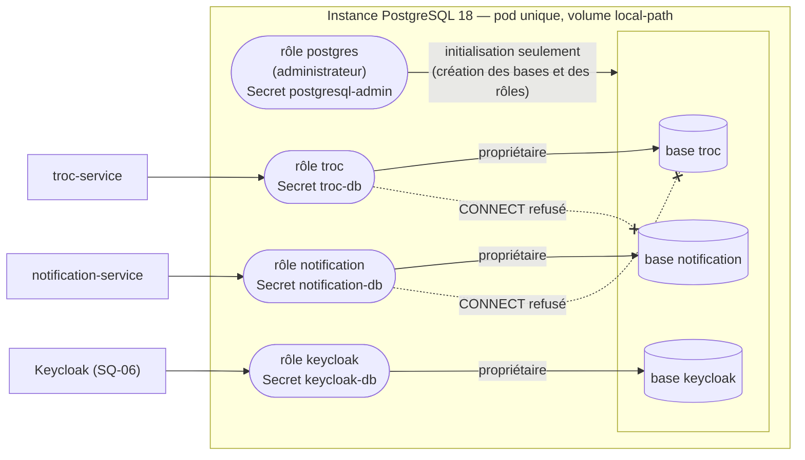
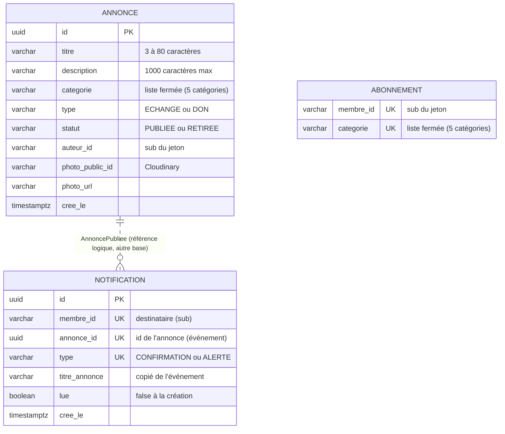

# Base de données — organisation et modèle cible

Sources : `docs/cadrage.md` §1.1 (points 1 à 5), §1.2 (points 7 et 8), §1.4.18 ; `docs/backlog/US1a` à `US5` ;
ticket SQ-04 ; ADR 0013. Images pour les slides : `bdd-organisation.png`, `bdd-modele-cible.png` (même dossier).

## 1. Organisation des bases (SQ-04)

Une seule instance PostgreSQL 18 dans le namespace `app` (`docs/cadrage.md` §1.4.18), une base par service et
**un rôle par base** : chaque rôle est propriétaire de sa base et n'a aucun droit sur les autres (`CONNECT` retiré à
`PUBLIC` sur chaque base). Chaque mot de passe est dans son propre Secret Kubernetes, généré sur le VPS.

- Le rôle `postgres` sert uniquement au script d'initialisation ; aucun service ne l'utilise.
- Chaque service applique ses migrations Flyway avec son propre rôle, propriétaire de sa base (ADR 0013).
- Aucune clé étrangère entre bases : les services ne partagent pas de données (`docs/cadrage.md` §1.2 point 7).

## 2. Modèle de données cible

> **Modèle cible** : les tables arrivent avec les user stories. `annonce` est implémentée depuis US1a (migration
> `V2__annonce.sql`, accès par `JdbcClient`, ADR 0019) ; `abonnement` depuis US2 (migration `V2__abonnement.sql` de
> `notification-service`, catégorie stockée par son code, index par catégorie pour US3) ; `notification` arrive avec US3.
> Noms de colonnes et types indicatifs ; les règles viennent du cadrage et du backlog.

| Table | Base | Contrainte d'unicité | Raison |
|---|---|---|---|
| `annonce` | `troc` | clé primaire `id` | — |
| `abonnement` | `notification` | `(membre_id, categorie)` | `PUT /abonnements/{categorie}` idempotent, pas de doublon (US2) |
| `notification` | `notification` | `(membre_id, annonce_id, type)` | idempotence du consommateur : un message livré deux fois ne crée qu'une notification (`docs/cadrage.md` §1.2 point 8, US3) |

- `annonce` est dans la base `troc` ; `abonnement` et `notification` sont dans la base `notification`
  (`notification-service` détient les abonnements, `docs/cadrage.md` §1.2 point 7).
- Les membres ne sont pas stockés : ils sont identifiés par le `sub` du jeton Keycloak (`docs/cadrage.md` §1.1 point 2).
- `annonce_id` n'est pas une clé étrangère : l'annonce est dans une autre base, l'identifiant arrive par l'événement
  `AnnoncePubliee`.
